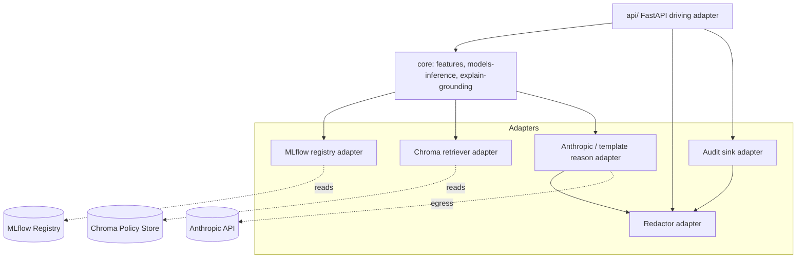
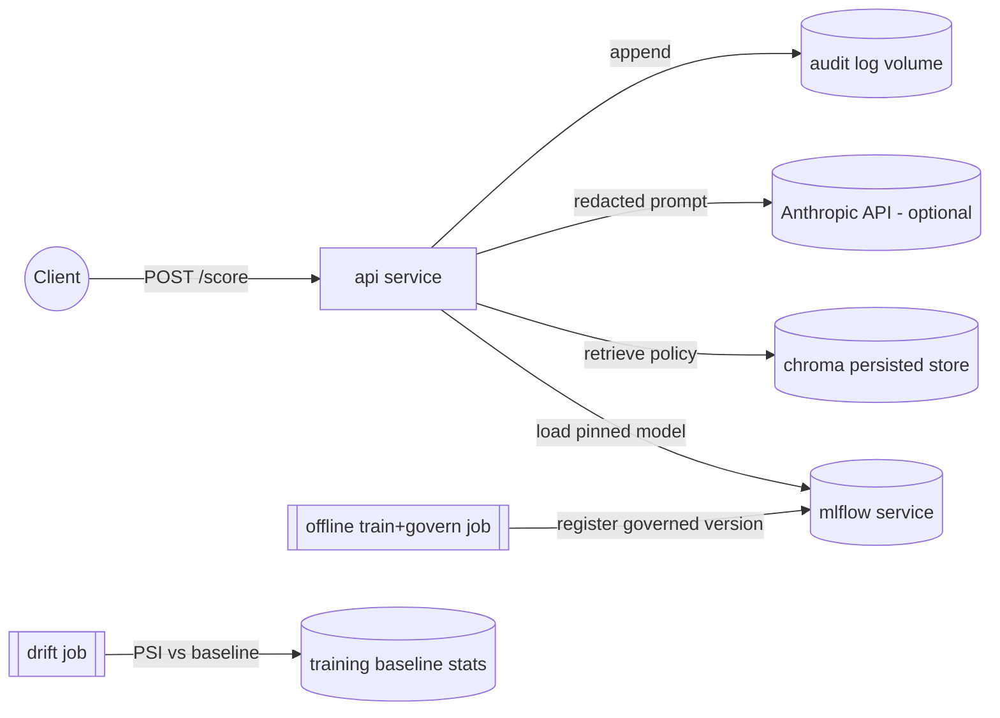

# Architecture Spine — CreditSentinel

## Design Paradigm

**Hexagonal (ports & adapters)** around a pure, dependency-free **decisioning core**. The core holds the logic that must be deterministic and unit-testable in isolation — feature transforms, the decision policy, SHAP driver extraction, and the reason-grounding contract. Everything with an external dependency (HTTP, MLflow, Chroma, Anthropic, the filesystem audit sink) is an **adapter** behind a **port** (a Python Protocol/ABC). This lets the whole `/score` path be tested with fakes and keeps the LLM and vector store swappable without touching decision logic.

Layer → package map (`src/creditsentinel/`):

| Layer | Package | Role |
| --- | --- | --- |
| Core (domain) | `features/`, `models/` (inference), `explain/` (driver extraction, grounding) | pure logic, no I/O |
| Ports | interfaces defined alongside `models/`, `rag/`, `explain/`, `api/` | `ModelRegistryPort`, `PolicyRetrieverPort`, `ReasonCodePort`, `AuditSinkPort`, `RedactorPort` |
| Adapters | `models/` (MLflow), `rag/` (Chroma), `explain/` (Anthropic + template), `governance/`, `monitoring/` | external systems |
| Driving adapter | `api/` (FastAPI) | translates HTTP ⇄ core |

## Invariants & Rules

### AD-1 — Two runtime planes, one registry as the seam
- **Binds:** all
- **Prevents:** the API drifting from what was trained; ad-hoc in-request training.
- **Rule:** The **offline pipeline** (`models/`, `governance/`) is the only writer to the MLflow Model Registry. The **online API** (`api/`) is read-only against the registry and **never trains**. The registry is the sole handoff between planes.

### AD-2 — Determinism is pinned and echoed
- **Binds:** FR-2, FR-9, `features/`, `models/`
- **Prevents:** silent scoring changes; non-reproducible decisions.
- **Rule:** The Feature Pipeline carries a `feature_pipeline_version`; inference pins an explicit `model_version`. Same input + same versions ⇒ identical features and PD. Every `/score` response **echoes both versions**. Seeds are pinned wherever randomness exists.

### AD-3 — No decline without grounded explanation
- **Binds:** FR-11, FR-14, FR-16, `explain/`
- **Prevents:** hallucinated / ungrounded adverse-action reasons.
- **Rule:** A `decline` response MUST contain SHAP top drivers **and** a Reason Code that references those actual drivers. The Reason Code is produced through one `ReasonCodePort`; both the Anthropic adapter and the deterministic-template adapter satisfy the same grounding contract (drivers + retrieved policy in, driver-referencing text out). The core asserts driver-reference regardless of which adapter ran.

### AD-4 — Redaction precedes every egress
- **Binds:** FR-12, FR-15, `api/`, `explain/`, `governance/`
- **Prevents:** raw PII leaving the process (LLM prompt, logs).
- **Rule:** A `RedactorPort` runs on applicant data **before** any external LLM call and **before** any Audit Log write. No adapter may bypass it. Raw PII never appears in prompts or logs.

### AD-5 — Ungoverned models cannot be registered
- **Binds:** FR-4, FR-5, FR-6, FR-7, `governance/`
- **Prevents:** unmonitored/undocumented models reaching serving.
- **Rule:** The registration adapter refuses a version unless core metrics (AUC-ROC, KS, Brier), calibration, a fairness parity metric, and a generated Model Card are all present and attached to the run.

### AD-6 — Dependencies point inward only
- **Binds:** all
- **Prevents:** the core importing framework/vendor code.
- **Rule:** Adapters depend on the core; the core depends on nothing outward. Vendor SDKs (fastapi, mlflow, chromadb, anthropic, shap) are imported only in adapter modules.

Dependency direction (who may depend on whom):



## Consistency Conventions

| Concern | Convention |
| --- | --- |
| Naming | packages/modules snake_case; ports `*Port` (Protocol); adapters `*Adapter`; Pydantic models PascalCase; FRs cited in docstrings where a module realizes one. |
| IDs & versions | `model_version` = MLflow registry version (int/str); `feature_pipeline_version` = semver string constant in `features/`; request `applicant_id` is pseudonymized before logging. |
| Data & formats | timestamps ISO-8601 UTC; money/amounts as numbers in a documented unit; API errors as FastAPI/Pydantic problem detail (422 for validation); PD ∈ [0,1] float. |
| Config | thresholds, top-N, PSI cutoff, model name, ANTHROPIC_API_KEY via env / `Settings` (pydantic-settings); no magic numbers in core. |
| State & logging | core is stateless & pure; the only persistent state is MLflow store, Chroma store, and the append-only Audit Log; logging is structured and post-redaction. |
| Errors | missing API key is not an error — it selects the template reason adapter; missing governed model at startup IS a hard error. |

## Stack

Verified as the current, defensible choices for this stack at authoring; the code owns exact pins via `pyproject.toml` / `uv.lock`.

| Name | Version |
| --- | --- |
| Python | 3.12 (pinned via uv; 3.14 present locally but ML wheels lag) |
| FastAPI + Uvicorn | current |
| Pydantic / pydantic-settings | v2 |
| scikit-learn | current |
| XGBoost | current |
| SHAP | current |
| MLflow | current (tracking + registry) |
| chromadb | current |
| anthropic (SDK) | current |
| pytest + pytest-cov + ruff | current |
| Docker + docker-compose | current |

## Structural Seed

```text
creditsentinel/
├── src/creditsentinel/
│   ├── config.py            # Settings (env): thresholds, top_n, psi_cutoff, model name, api key
│   ├── features/            # deterministic versioned Feature Pipeline (core)
│   ├── models/              # training entrypoint + inference + ModelRegistryPort/MLflow adapter
│   ├── governance/          # metrics (AUC/KS/Brier), calibration, fairness, model-card gen, registration gate
│   ├── explain/             # SHAP driver extraction (core) + ReasonCodePort (Anthropic + template adapters) + grounding assert
│   ├── rag/                 # PolicyRetrieverPort + Chroma adapter + ingest of policy/model-card docs
│   ├── monitoring/          # PSI drift job vs training baseline
│   └── api/                 # FastAPI app: /score (+ /health); request/response Pydantic models; RedactorPort + AuditSinkPort adapters
├── data/                    # synthetic/public dataset + PROVENANCE note (baseline stats for PSI)
├── policies/                # source risk-policy + model-card docs for the RAG store
├── tests/                   # pytest ≥80% on core; includes driver-reference + governance-gate + drift tests
├── mlflow/                  # local tracking/registry store (mounted volume)
├── docker-compose.yml       # api + mlflow + (chroma persisted volume)
├── Dockerfile
├── pyproject.toml
└── .github/workflows/ci.yml # ruff + pytest
```

Container topology:



## API Contract — `POST /score`

Request (`ScoreRequest`, Pydantic v2): validated applicant features + `applicant_id`. Invalid → 422.

Response (`ScoreResponse`):

```json
{
  "applicant_id": "pseudo_a1b2",
  "pd": 0.83,
  "decision": "decline",
  "thresholds": {"approve_below": 0.2, "decline_at_or_above": 0.6},
  "model_version": "3",
  "feature_pipeline_version": "1.0.0",
  "drivers": [
    {"feature": "debt_to_income", "shap": 0.41, "direction": "increases_risk"},
    {"feature": "num_delinquencies", "shap": 0.22, "direction": "increases_risk"},
    {"feature": "credit_utilization", "shap": 0.13, "direction": "increases_risk"}
  ],
  "reason_code": {
    "text": "Application declined primarily due to a high debt-to-income ratio, recent delinquencies, and elevated credit utilization ...",
    "grounded_in": ["debt_to_income", "num_delinquencies", "credit_utilization"],
    "policy_refs": ["risk-policy#adverse-action", "model-card#limitations"],
    "generator": "anthropic|template"
  },
  "audit_id": "..."
}
```

Auxiliary: `GET /health` (liveness + whether a governed model is loaded).

## Capability → Architecture Map

| Capability / FR | Lives in | Governed by |
| --- | --- | --- |
| FR-1..FR-7 Training & governance | `models/`, `governance/`, `data/` | AD-1, AD-5 |
| FR-2 Deterministic features | `features/` | AD-2 |
| FR-8..FR-12 Scoring API core | `api/`, `models/`, `explain/` | AD-2, AD-3, AD-4 |
| FR-11 SHAP drivers | `explain/` (core) | AD-3 |
| FR-13..FR-16 RAG + reason code | `rag/`, `explain/` | AD-3, AD-4 |
| FR-15 PII redaction | `api/` redactor + `explain/` | AD-4 |
| FR-17 Drift | `monitoring/` | AD-1 (reads baseline, not registry) |
| FR-18..FR-20 Packaging/CI/docs | compose, `.github/`, `README.md` | conventions |

## Deferred

- **Exact decision thresholds & expected-loss calibration** — set during Slice 1/2 against the trained model; config-driven so no code change needed.
- **`/ask` chat endpoint, demo UI, LLM-as-judge eval, champion/challenger, telemetry, auto-retrain** — stretch, out of MVP scope (PRD §6.2); the ports (`PolicyRetrieverPort`, registry) already leave room.
- **Auth / rate limiting on the API** — not needed for a local/synthetic portfolio artifact; noted as a real production concern in the README.
- **pgvector alternative** — Chroma chosen for zero-infra; `PolicyRetrieverPort` keeps the swap cheap.
